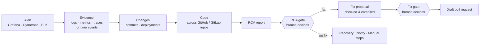

# rca-agent

An AI agent that finds the root cause of production incidents in Java services on Azure, and proposes a fix that a human approves.

> **Status: planning.** The repository holds the glossary, decisions and research for a build-ready spec. There is no application code yet. Progress lives on the [planning map](https://github.com/chiyanram/rca-agent/issues/1).

## What it does

An Operator picks an alert (or pastes one), and the agent runs an **Investigation**:

- **Every Investigation ends in an RCA report** with cited evidence: queries with links, code at the deployed commit.
- **Humans decide** at two mandatory gates. The agent never merges, deploys, restarts or rolls back; those stay Manual steps.
- **Backend-neutral**: per-signal Observability adapter (Grafana, Dynatrace, ELK), GitHub or GitLab, Gradle or Maven.
- **Provider-neutral**: runs on any capable model provider; nothing hard-depends on one AI vendor.
- **Graded, not guessed**: a Test bed of seeded faults with hidden answer keys measures every Agent version.

Target services: Java (Spring or Micronaut, Gradle or Maven) on Azure, including Azure Functions, built with GitHub Actions or GitLab CI.

## Principles

The full list, each linked to the ticket that decided it, is in **[docs/principles.md](docs/principles.md)**. In short:

| | Principle |
|---|---|
| 🧭 | **[12-factor agents](https://github.com/humanlayer/12-factor-agents)**: we own prompts, context and control flow; small focused agents; pause and resume at gates |
| 🙋 | **Humans decide**: two mandatory gates, no auto-merge, and the agent never changes production directly |
| 🔎 | **Evidence, not assertion**: every claim is a cited Finding; what code can compute, code computes |
| 🛡️ | **Everything read is data, not instructions**: redaction at ingestion, least-privilege tokens minted late |
| 🔌 | **Neutral by design**: any model provider, any supported observability or source-control backend, each a built-in Plugin whose transport (own code, CLI or MCP) stays hidden |
| 📏 | **Graded, not guessed**: seeded faults with hidden answer keys, and capped spend |

## Key decisions

Architecture decision records in [`docs/adr/`](docs/adr/):

| ADR | Decision |
|---|---|
| [0001](docs/adr/0001-own-pipeline-small-agent-per-stage.md) | Our own pipeline, with one small Pydantic AI agent per Stage |
| [0002](docs/adr/0002-event-log-is-the-source-of-truth.md) | The append-only event log is the source of truth and the audit trail |
| [0003](docs/adr/0003-operator-always-starts-an-investigation.md) | An Operator always starts an Investigation; alerts never do |
| [0004](docs/adr/0004-agent-never-changes-production-directly.md) | The agent never changes production directly |
| [0005](docs/adr/0005-provider-neutral-models.md) | Models are provider-neutral; nothing hard-depends on Claude |

Every other decision is one line in the map's *Decisions so far*, linked to its ticket.

## How to follow the planning

1. Open the [planning map](https://github.com/chiyanram/rca-agent/issues/1): **Decisions so far** is what is settled, **Not yet specified** is what is still open.
2. Each line links a closed ticket whose last comment is the full resolution.
3. Open tickets are the frontier; unassigned ones with no open blockers can be picked up (see [CONTRIBUTING.md](CONTRIBUTING.md)).

## Planned stack

Python · Pydantic AI (one small agent per stage) · FastAPI · Postgres · AG-UI frontend · Docker Compose test bed.

## Repository layout

| Path | What |
|---|---|
| [`CONTEXT.md`](CONTEXT.md) | Glossary: one term, one meaning |
| [`AGENTS.md`](AGENTS.md) | Instructions for AI coding agents (`CLAUDE.md` imports it) |
| [`docs/principles.md`](docs/principles.md) | The rules every design decision follows |
| [`docs/adr/`](docs/adr/) | Architecture decision records for hard-to-reverse choices |
| [`docs/agents/`](docs/agents/) | Issue-tracker workflow, triage labels, domain-doc rules |
| [`CHANGELOG.md`](CHANGELOG.md) | Release notes, generated from commits |
| `research/*` branches | Research findings, one branch per ticket |
| `prototype/*` branches | Throwaway prototypes |

## Contributing

See [CONTRIBUTING.md](CONTRIBUTING.md). In short: pick a ticket from the map, use the glossary's terms, write [Conventional Commits](https://www.conventionalcommits.org/). Releases and the [changelog](CHANGELOG.md) are generated from those commits.

Security issues: see [SECURITY.md](SECURITY.md).

## License

Proprietary. All rights reserved. See [LICENSE](LICENSE).
